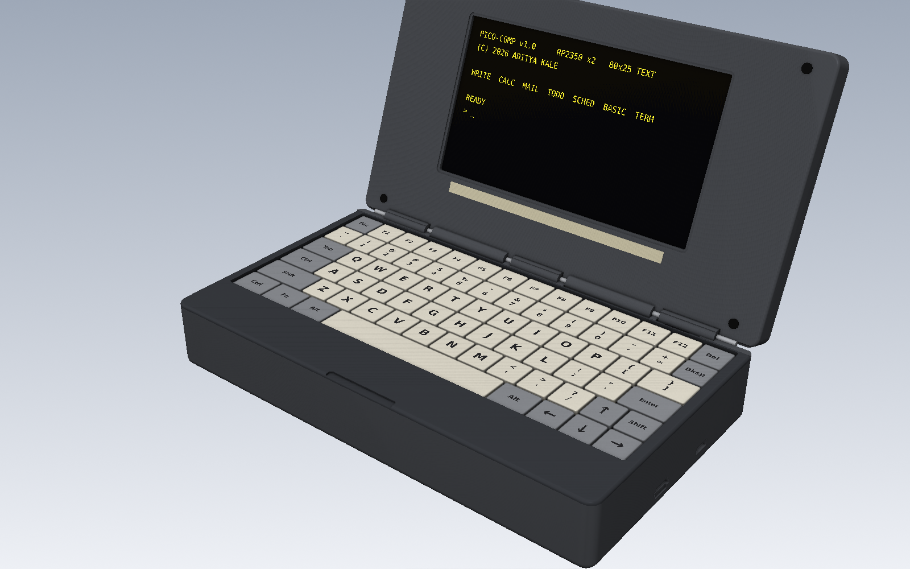

# Pico-COMP

**A modern take on the TRS-80 Model 100: a text-only, battery-powered portable computer built on two
Raspberry Pi RP2350 microcontrollers.**



Pico-COMP is a clamshell laptop for writing and focused work: a full-size mechanical keyboard, a 7"
display driven in 80-column text mode (amber, green or white on black), a week of standby on a 2S2P
18650 pack, and Wi-Fi for mail, chat and file sync. Everything is programmed in C on the RP2350's RISC-V
cores, and every board, case part and keycap is generated from scripts in this repository.

> **Status (Nov 2026):** the keyboard PCB, switch plate, keycaps and battery spec are ready to order. The
> main board design is final (schematic ERC-clean, placement and design rules done) and is being routed:
> automated routing is down to a handful of connections. Firmware: display driver and project skeleton.

| Part | State |
|---|---|
| Keyboard PCB (2 layers) | Routed, KiCad DRC 0 / ERC 0, fab package in `hardware/fab/keyboard/` |
| Switch plate | Laser-cut DXF ready (1.2 mm) |
| Keycaps (75) | Print-ready STEP/STL with debossed legends + inlays |
| Main board (6 layers) | Schematic + placement final; routing in progress |
| Case | Parametric FreeCAD assembly, printable parts, no interferences |
| Firmware | Builds for both MCUs; HSTX DVI text driver (untested on hardware) |

---

## Features

- **Display:** 7" 1024x600 IPS HDMI panel fed 720x400 / 640x480 DVI straight from the RP2350's HSTX
  peripheral, as 80x25 / 80x30 text; amber-on-black, green-on-black and black-on-white schemes.
- **Keyboard:** 75 keys, Kailh Choc V1 low-profile switches at 17 mm pitch, inverted-T arrows (the only
  navigation), Fn layer for hotkeys, Kailh plate-mount stabilizers on Shift and Space.
- **Storage:** 64 GB soldered eMMC (internal disk) plus a microSD slot for extra space / file exchange;
  16 MB QSPI flash per MCU for firmware.
- **Wireless:** Wi-Fi 4 + Bluetooth 5.2 (Raspberry Pi RM2 / CYW43439, the Pico 2 W radio).
- **USB:**
  - USB-C port 1: dual-role (TUSB320). Device mode for charging, flashing, file transfer and serial;
    host mode for USB printers, barcode scanners and keyboards.
  - USB-C port 2: the network MCU's own USB.
- **Power:** custom 2S2P 18650 pack (7.4 V, 44 Wh), TI BQ25798 USB-C buck-boost charger, 5 V and 3.3 V
  buck converters, switched panel power for standby. Target: one week standby, ~4 days of normal use.
- **I/O:** serial printer port (JST-SH, UART with RTS/CTS), expansion header (6 GPIO + I2C/SPI),
  piezo beeper.
- **Software (planned):** text editor, spreadsheet, database, mail, IM (IRC/Matrix), file sync web
  page, scheduler, todo, BASIC calculator, SSH/terminal, Gopher/Gemini, RSS, games. See `intent.md`.

## Architecture

Two RP2350s split the work so the UI never stalls on the network:

```
            USB-C 1 (dual-role)            HDMI (internal) -> 7" panel
                  |                              ^
   +--------------+------------------------------+--------------------+
   |  UI MCU: RP2350B (QFN-80)                                        |
   |  HSTX DVI text display, all apps, eMMC 64 GB (PIO 4-bit),        |
   |  microSD (SPI0), printer UART1, expansion, beeper, panel power   |
   +--------------+---------------------------------+-----------------+
                  | UART0 link (framed packets)     | SWD (UI reflashes NET)
   +--------------+---------------------------------+-----------------+
   |  NET MCU: RP2350A (QFN-60)                                       |
   |  Wi-Fi/BT (RM2, PIO gSPI), keyboard matrix scan (6x14),          |
   |  BQ25798 charger + TUSB320 over I2C, USB-C 2                     |
   +-------------------------------------------------------------------+
```

- Inter-MCU protocol: `[0xA5][type][len][payload][crc8]`, see `firmware/common/link.h`.
- Full GPIO map for both MCUs: `firmware/common/pins.h`.
- Design notes: `docs/architecture.md`, `docs/hardware-plan.md`.

## Firmware updates

- **Normal update:** connect USB-C port 1 to a computer. An "update firmware" hotkey (or
  `picotool reboot -u`) puts the UI MCU into the RP2350 USB bootloader, where it appears as a drive. Copy
  one `.uf2`. The UI image carries the NET MCU firmware and rewrites it over SWD when the version differs.
- **Recovery:** double-tap the reset button through the pinhole in the right side wall, which brings up
  the USB update drive (`pico_bootsel_via_double_reset`). BOOTSEL buttons inside the case are the last
  resort.
- **NET MCU direct:** USB-C port 2.

## Repository layout

```
firmware/            C firmware (Pico SDK, RISC-V)
  ui/                UI MCU: HSTX DVI text driver, font, main
  net/               NET MCU (stub)
  common/            link protocol, pin map
  boards/            pico_comp.h board header (16 MB flash, per-target RP2350A/B)
hardware/
  keyboard/          layout.py (single source of key positions), PCB + schematic generators
  mainboard/         PCB + schematic generators, fan-out, routers (Freerouting driver, maze router)
  kicad/             KiCad 10 projects, project libraries (footprints, symbols, 3D models), helpers
  mechanical/        FreeCAD case/assembly generator, keycaps, renders, print files
  fab/               fabrication packages and order sheets
  placement.py       where the boards sit in the case
docs/                architecture, hardware plan, routing guide, case dimensions
tools/               font converter
```

## Building the firmware

Requirements: [Raspberry Pi Pico SDK](https://github.com/raspberrypi/pico-sdk) 2.x and a RISC-V
toolchain (`riscv32-unknown-elf`, as distributed for the Pico SDK).

```sh
export PICO_SDK_PATH=~/pico-sdk          # default
export RISCV_TC=~/toolchains/riscv        # default
./build.sh
# -> build/firmware/ui/comp_ui.uf2, build/firmware/net/comp_net.uf2
cmake --build build --target comp_ui     # rebuild one target
```

Firmware is C11 only. The board header `firmware/boards/pico_comp.h` describes this hardware; the UI
target is built for the RP2350B package (`PICO_RP2350A=0`).

## Hardware

Nothing under `hardware/` is drawn by hand: every board, schematic, footprint, 3D model, case part and
keycap is generated by the Python scripts next to it, and opened and checked in KiCad / FreeCAD.

| Board | Size | Layers | Notes |
|---|---|---|---|
| Main board | 152 x 84 mm | 6 (sig / GND / sig / sig / 3V3 / sig) | 5-mil rules, 0.45/0.2 vias, via-in-pad under the eMMC BGA |
| Keyboard | 244 x 120 mm | 2 | 75 Choc V1 (top, THT), 75 diodes (bottom, SMD) |

Key parts: RP2350A + RP2350B, W25Q128JV flash x2, BQ25798 charger, TPS62933 (5 V) and AP63203 (3.3 V)
bucks, TPS22917 panel switch, TUSB320 USB-C controller, Raspberry Pi RM2, 64 GB eMMC (Kimtigo
KM110SS1064GxA), Hirose microSD, Molex HDMI, HRO USB-C x2, XT30 battery connector.

### Tools
- KiCad 10 (with `pcbnew` Python), FreeCAD 1.x (`FreeCADCmd`), Java 21 + Freerouting 2.1 (routing only).

### Regenerating
The full order is at the end of `docs/hardware-plan.md`. In short:

```sh
python3 hardware/keyboard/layout.py                        # key positions, plate.dxf
python3 hardware/kicad/make_footprints.py                  # RM2, Choc and stabilizer footprints
FreeCADCmd hardware/kicad/make_3d.py                       # STEP models missing from KiCad's library
python3 hardware/mainboard/gen_pcb.py && python3 hardware/mainboard/gen_sch.py
python3 hardware/keyboard/gen_pcb.py  && python3 hardware/keyboard/gen_sch.py
python3 hardware/mainboard/fanout.py hardware/kicad/mainboard.kicad_pcb    # plane, BGA, dog-bone fan-out
python3 hardware/mainboard/route.py  hardware/kicad/<board>.kicad_pcb 40   # Freerouting
python3 hardware/mainboard/maze_route.py hardware/kicad/<board>.kicad_pcb  # finish leftovers
sh hardware/kicad/fab.sh                                   # ERC/DRC gate + all fab outputs
python3 hardware/kicad/export_parts.py && FreeCADCmd hardware/mechanical/case.py
FreeCAD hardware/mechanical/open_gui.py                    # open the assembly (saves colours)
```

Schematic and PCB are generated from one netlist and linked symbol-to-footprint, so ERC and
schematic-parity DRC must stay at zero. `fab.sh` refuses to export a board that fails either.

### Case and keycaps
- Laptop-style split: bottom tub (D-cover), top deck (C-cover) flush with the rim, lid shell + back
  cover, hinge on a steel pin. 250 x 140 mm footprint, 52 mm closed.
- Printable parts (STEP + STL) in `hardware/mechanical/print/`: base, deck, lid, lid back.
- Keycaps in `hardware/mechanical/keycaps/`: Choc V1 stems, legends debossed 0.5 mm with matching
  inlay bodies for two-colour printing; Shift/Space carry stabilizer pegs.
- Review renders: `FreeCADCmd hardware/mechanical/render_export.py && python3 hardware/mechanical/render.py`.

## Ordering

Everything is set up for [robu.in](https://robu.in) (PCB fab + assembly, laser cutting, 3D printing,
custom Li-ion packs); the files are standard and work with any fab.

- What goes where: `hardware/fab/ORDER-CHECKLIST.md`
- Keyboard PCB order sheet: `hardware/fab/keyboard/ORDER.md` (assemble the diodes only; the switches
  are soldered after they are clipped into the plate)

## Open items

- Finish main board routing, then its fab package and order sheet.
- Measure the display module (thickness, outline) and the HDMI cable; adjust the lid.
- Size the battery bay to the delivered pack.
- Firmware: key scanner, UART link, eMMC (PIO SD/MMC) and USB host drivers, NET reflash over SWD,
  file system, apps.

## Credits

Designed by Aditya Kale. Terminus font (SIL OFL 1.1). Built on the Raspberry Pi Pico SDK, KiCad,
FreeCAD and Freerouting.

© 2026 Aditya Kale. Licensed under the GNU General Public License v3.0, see [LICENSE](LICENSE).
